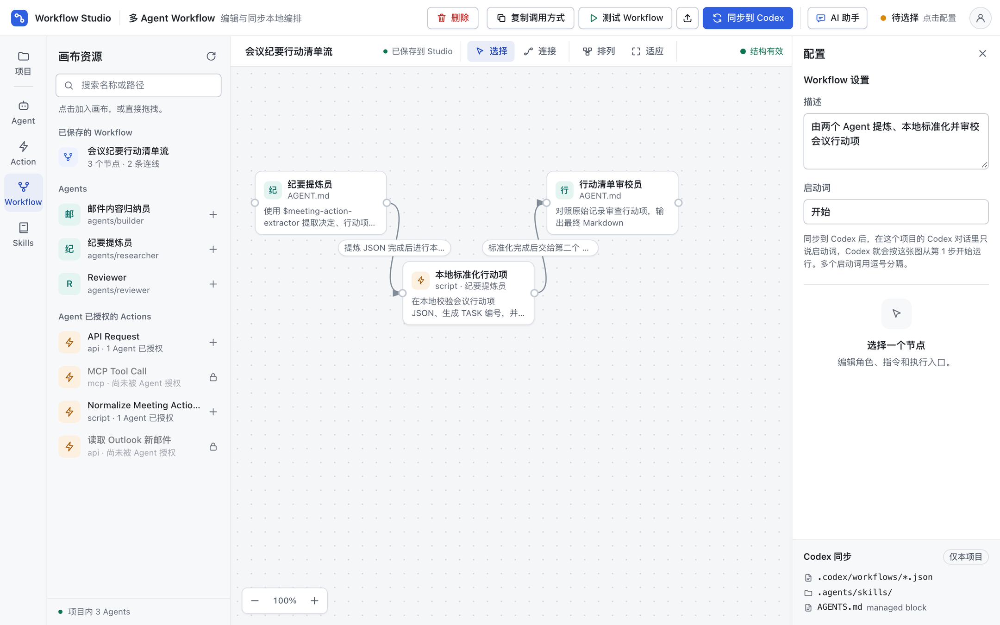
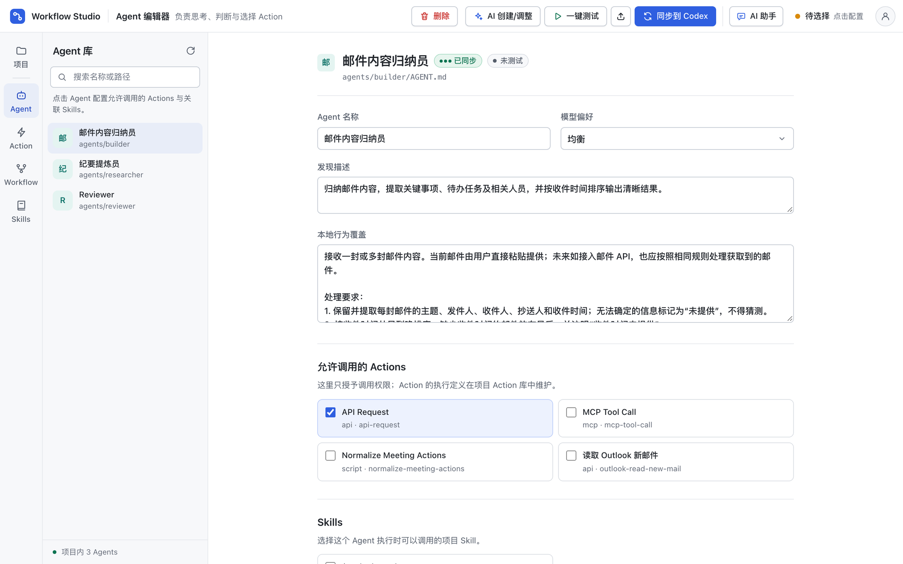
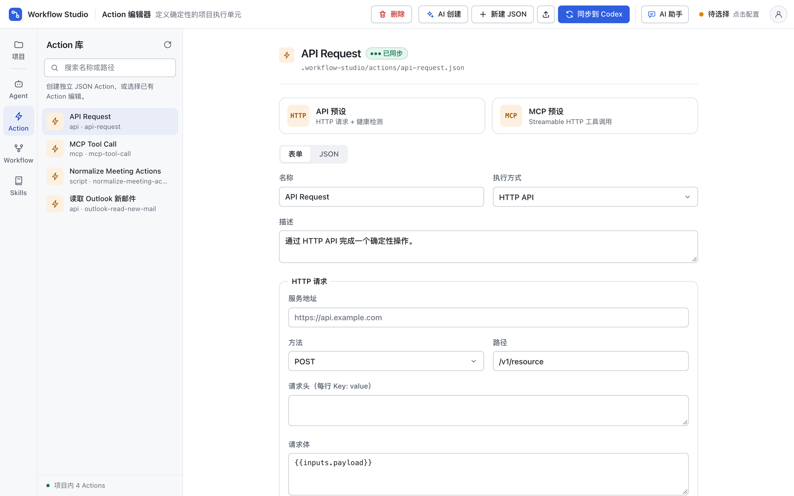

<div align="center">


# Workflow Studio

**Turn scattered agents into workflows you can see.**

A local visual workbench for Codex, Claude Code, Qwen Code and OpenCode: draw multi-agent workflows on a canvas and sync them into your repo as plain `AGENTS.md` + skill files.

[中文](README.md) · [Quick start](#quick-start) · [Full promo video](https://github.com/wangyichuan0609-tech/workflow-studio/releases/latest) · [MIT License](LICENSE)

</div>

**What it is**: a local editor for the agents, skills and scripts in your repo. You decide who does what, which tools each agent may use, and the order of handoffs on one canvas. Studio writes that out as ordinary config files. Your existing AI coding tool runs the workflow; Studio never does.

- **Agent**: a role defined by a prompt file (`AGENT.md`, `SKILL.md`, ...).
- **Skill**: a `SKILL.md` your AI tool can invoke.
- **Action**: a fixed step (a script, an API call or an MCP tool) that runs exactly as declared, with no LLM judgment.



> Screenshots show the Chinese UI. Switch the interface to English under **Language** in the profile menu (top right); a few messages, such as test-result toasts, are still Chinese only.

## Quick start

Requirements: Python 3.9+ and one AI coding tool (Codex, Claude Code, Qwen Code or OpenCode). No pip install, no npm.

```bash
git clone https://github.com/wangyichuan0609-tech/workflow-studio.git
cd workflow-studio
python3 server.py
```

1. Open [http://127.0.0.1:4173](http://127.0.0.1:4173) in your browser. **Fastest way to try it:** accept the hands-on tutorial offered on first launch. It builds a practice project, so you don't need to touch your own repo.
2. In the **Projects** panel on the left, pick your project (or click **+** to add any local folder), then click **Authorize & import**. The Agents, Skills, Actions and Workflows already in the project show up automatically.
3. Connect Agents and Actions on the canvas, give the Workflow a start phrase (for example "start"), click **Sync to Codex** (this also writes the files for Claude Code and Qwen Code if you enable them on the Project page; OpenCode reads the same files as Codex), then review the list of files it will write. Now type "start" in Codex and it runs the workflow from the first step to the last.

## How it differs from similar products

Plenty of products let you "build AI workflows", but they solve different problems:

| What you may have seen | What it's good at | How Workflow Studio differs |
|---|---|---|
| **Online agent platforms** (e.g. Coze, Dify) | Building and running chatbots and AI apps on their platform | No moving to a new platform. It configures a team for the Codex, Claude Code and other tools **you already use**, and workflows run inside your own project |
| **Automation tools** (e.g. n8n, Zapier) | Chaining apps together in fixed steps: "when an email arrives, save it to a spreadsheet" | It orchestrates AI roles that **think and make judgment calls**, and spells out exactly which tools each role may touch, rather than just rigid steps |
| **AI frameworks / visual builders** (e.g. LangGraph, LangFlow) | Building your own LLM apps in code and deploying them | No code, no servers to deploy. Draw connections on a canvas and they become configuration your AI tools understand |
| **Hand-editing your AI tools' config files** | Maximum flexibility; you can change anything | No digging through a pile of text files. Every role and relationship is visible on one canvas, and mistakes get flagged |

### What you get

- **No new tool, no extra subscription**: workflows run on the Codex, Claude Code, Qwen Code or OpenCode you already have, using the plans you already pay for. Configure once and sync to several tools at the same time.
- **Start with a single word**: give a workflow a start phrase such as "start". Say just that word in your AI tool and it works through the whole job in order, from the first step.
- **See who does what at a glance**: what each AI role is responsible for, which tools it can use and who it hands off to are drawn as nodes and edges instead of being buried in files.
- **You review every change; nothing is written behind your back**: all edits are saved as drafts first. Project files only change after you click "Sync" and confirm, in a preview, exactly which files will be modified.
- **Authorize first, then act**: before an AI role can use a tool (calling an API, running a script), you have to grant it permission; unauthorized connections are blocked outright. Passwords and keys never go into the config; only the name of the credential to use is stored.
- **Your data stays on your machine**: it runs locally and has no cloud server of its own. It does not read a project's contents until you select and authorize that project. Only when you actively use the built-in AI Assistant is what you send passed to the AI service you chose (Codex or an API you entered).
- **No lock-in**: it produces ordinary files that your AI tools already understand. If you stop using Workflow Studio one day, the configuration keeps working.
- **Lightweight**: if you have Python, it runs. Pure Python standard library: no packages, no downloads.

### What it doesn't do

To be clear about the boundaries: Workflow Studio is **not** an online platform, and it **does not run** workflows or execute scripts by itself. Its job is to design, check and sync; execution is left to the AI coding tools on your computer. If what you need is a public-facing chatbot or a cloud workflow that runs on a schedule, the other products in the table above may be a better fit.

## A look at the UI

| Agent: responsibilities, allowed Actions and Skills | Action: define a fixed script, API or MCP step with a form |
|---|---|
|  |  |

Canvas connections follow the usual node-editor interaction: press on a node's right-hand port and drag to the target node's left-hand port. Clicking an existing edge selects it and shows **Delete connection**; you can also press Delete or Backspace.

## Run options

By default the server listens on localhost (127.0.0.1) only.

You can also keep the editor in a separate directory and point it at your actual project:

```bash
python3 server.py --project /absolute/path/to/your/project --port 4173
```

## Agent discovery rules

Copy an Agent folder downloaded from GitHub into any non-hidden directory of your project. Each Agent directory should contain one of these entry files:

- `AGENT.md` / `agent.md`
- `SKILL.md`
- `prompt.md`
- `agent.json` / `manifest.json`

Markdown files can use `name`, `description` and `model` frontmatter; JSON files can use fields with the same names. Click the refresh button on the left side of the UI and the new Agent appears.

> Safety note: review imported third-party Agents before running them, and test and check AI drafts before publishing them to Studio and explicitly syncing them to Codex.

## Project workspace and persistence

- **Agent**: edit the name, description, the local behavior override (extra project-level instructions added on top of the Agent's entry file), allowed Actions and linked Skills. Syncing generates an `$agent-<id>` project skill.
- **Action**: define project-level deterministic execution with a form (execution type, command or request, inputs and outputs, success criteria, timeout, retries, credential references), with JSON, from an API or MCP preset, or with AI. The editor can run a manual, read-only connectivity check: for APIs it only sends a HEAD/GET health request, for MCP it only performs the `initialize` handshake. Studio itself never executes Actions.
- **Workflow**: add Agents and authorized Actions to the canvas, connect them and edit handoff conditions; fill in the description and start phrases (e.g. "start") under **Workflow settings** on the right. Syncing generates `$workflow-<id>`, and saying the start phrase in the project's Codex chat runs it from step 1.
- **Skills**: import, edit and sync `SKILL.md` files in the selected project.
- **AI**: create or adjust Agents, Skills and Actions in natural language. The AI asks clarifying questions when needed, and its output always lands in an unpublished draft area first.

On startup, the **Projects** panel on the left lists the projects you've opened in Codex (titles only, through `/api/codex/projects`; no project files are read). You can also click **+** at the top right of the panel to add any local folder (macOS opens the system folder picker; elsewhere you type the full path), without opening it in Codex first. Only after you select a project and explicitly click **Authorize & import** does Studio scan that project, read-only, for Agents, Actions, Workflows and Skills; it never reads conversations outside the project. Once authorized, a read-only refresh runs automatically whenever you open the project or the window regains focus.

Everything you create, edit or generate with AI is saved automatically to Studio's SQLite database; on macOS the default location is `~/Library/Application Support/Workflow Studio/state.sqlite3`. Saves are debounced by about 500 ms, and pending changes are flushed immediately before you switch pages. Full AI conversations and attachments are not kept long-term.

**Publish to Studio** only marks the current resource as ready to sync; it does not write project files. The main button on a resource page, **Sync to Codex**, first publishes the resource automatically if it is still a draft, then shows a write preview; project files are written only after you confirm. Editing a resource that was already published or synced puts it back into draft. Only the "Sync to Codex" endpoint can invoke the project file writer; resources belong to the current project and are never written to Codex's global directory.

Several browser tabs can work on different projects at once. If you and your AI tool edit the same field, Studio shows the conflict and lets you choose which version to keep; changes to different fields merge automatically. If a Codex file is deleted outside Studio, Studio still keeps a recoverable record and marks it **Source missing**.

An Agent's **Smoke test** runs in the background against the current Studio draft: with a compatible API configured it sends one request without tools; otherwise it uses `codex exec --ephemeral --sandbox read-only`. The start call returns immediately, and switching pages, refreshing or closing the tab does not cancel the job; when it finishes, a notification shows "<Agent name> 测试通过" (passed) or "<Agent name> 测试未通过" (failed); this message is not translated yet. It only checks that the Agent's entry file and instructions load and produce a response, not the final result of a real task, and the test conversation is not kept. Editing the draft invalidates the old result automatically.

## Connection center and AI Assistant

The AI Assistant can use two kinds of connection:

- **Codex**: the UI starts `codex login --device-auth` and shows only the official OpenAI link, a one-time device code and the sign-in status. Studio never touches your ChatGPT password or access tokens, and calls use your Codex plan's quota. The model follows Codex's default; advanced users can enter a model ID by hand.
- **Custom API**: enter an endpoint and key, then pick a model from what `/models` actually returns; calls are billed by your API provider. **Save the API key on this device** is off by default; if you don't save, the key lives only until the server process exits. When saved, it is written to `connections.json` in Studio's app data directory with permissions `0600`.

When both Codex and an API are available you must explicitly choose the active provider; a failed request never switches providers automatically. The legacy `AI Assistant Info.json` in a project root is not migrated, read or deleted. You can also supply an API connection for the current process through environment variables:

```bash
cd workflow-studio
OPENAI_API_KEY="your-key" OPENAI_MODEL="gpt-5-mini" python3 server.py
```

Click the connection status in the top-right corner, or **Connection settings** in the local profile menu, to open the connection center. Click **AI Assistant** to open the in-app helper and ask it directly how to create, authorize and orchestrate resources.

The AI Assistant and the AI creation workspace share the same input behavior: `Enter` inserts a new line and `Cmd/Ctrl + Enter` sends. Images, PDFs and common text/code attachments are supported; add them by clicking, dragging or pasting. While a response is generating, the send button turns into **Stop generating**. Attachments are only context for the current conversation and are never written to the project. PDFs need a connection compatible with the Responses API; the local Codex fallback supports images and text/code attachments, and tells you clearly when a PDF is not supported.

The page periodically re-checks the current connection. The API key is only ever used inside the local Python server; it is never returned to the browser or written to the project.

After you authorize and import a project, click **Create / adjust with AI** (on Agents) or **Create with AI** (on Skills and Actions) in the editor:

1. Describe what you need in natural language and answer any clarifying questions;
2. Edit the AI-generated draft directly on the right;
3. For an Agent draft, enter a sample task and run a read-only throwaway test;
4. Click **Publish to Studio** to mark the current version as ready to sync;
5. When you want it in your project, go to the resource page and explicitly click **Sync to Codex**.

The AI conversation only receives the current project's resource names, your input and the current draft; it never reads or includes Codex conversations from outside the project. The model cannot choose where files are written: the sync targets are fixed and validated by the server. The latest AI draft is saved in the Studio database, so it survives page switches and server restarts.

## Agent-to-agent (A2A) beginner tutorial

On a fresh install (a new state database), version 0.6.0 offers the hands-on tutorial once. Existing users upgrading won't see the prompt; you can start it manually from **Beginner tutorial** in the local profile menu (top right). The tutorial:

1. Creates an isolated `workflow-studio-tutorial` project in Studio's app data directory when needed;
2. Has you authorize the read-only import yourself, then seeds only the Studio database with a "Requirements Clarifier", a "Plan Reviewer" and a blank A2A Workflow;
3. Runs two real-model smoke tests using a fixed task (a Python CLI CSV export), then has you connect the nodes, set the handoff condition, run the Workflow Dry-run and publish;
4. After previewing dependencies and the exact target files, asks you to confirm a batch sync once more.

Failed tests are never retried automatically. Tutorial progress is driven by the backend from the real state of resources, tests and syncs, and you can pause at any point. When you finish, you can keep the practice project or, after a second confirmation, delete it completely. Cleanup only deletes the tutorial's own folder (it must sit in the app data area, match the session marker and not be a symlink); the "tutorial completed" status is kept.

## Syncing to Codex

A resource page syncs the current resource; the Project page lets you preview additions, changes, deletions, dependencies and target files in bulk before you confirm. Sync order is Skill/Action → Agent → Workflow. If a dependency hasn't been synced yet, the current resource is blocked.

Each resource's multi-file write is its own atomic transaction: on failure, all of that resource's target files are rolled back, while other resources in a batch sync carry on; successful ones stay, failed ones remain pending. Deleting in the web UI first moves a resource to `pending_delete`; the recorded Codex target files are removed only after you confirm again in the sync preview, and Studio still keeps a recoverable record.

Syncing a Workflow writes:

- `.codex/workflows/<id>.json`: the canonical data for the canvas;
- `.agents/skills/workflow-<id>/SKILL.md`: the workflow skill Codex can invoke;
- `.agents/skills/workflow-<id>/agents/openai.yaml`: skill UI metadata;
- `AGENTS.md`: only the index between the two managed markers is updated; everything else you wrote by hand is preserved.

Syncing an Agent additionally writes `.workflow-studio/agents/<id>.json` and `.agents/skills/agent-<id>/`, while the body of the original entry file is preserved.
Actions are written to `.workflow-studio/actions/<id>.json`; an Agent's config stores only the IDs of the Actions it is allowed to call, and Action steps are never copied into the Agent prompt.

After syncing, you can type `$workflow-<id> your task` in a Codex task for the current project; a Workflow with start phrases only needs the phrase itself (for example "start"). Start phrases are written into the managed block in `AGENTS.md` and into the workflow skill's description; start phrases must be unique within a project. The generated skill is a step-by-step execution protocol: it first lists the steps, runs Agent steps as sub-agents that read their entry file first, runs Action steps exactly as declared, runs steps that don't depend on each other (the same topological layer) in parallel, and finally reports a ✅/❌ status for each step.

An Agent can only be synced after its current draft passes its test. A Workflow's **Test Workflow** is a read-only Dry-run: it checks the DAG, that resources exist, Action authorization, runtime bindings, topological layers and the handoff plan. It does not run Agents or Actions and does not write project files. Publishing and syncing a Workflow both re-check the current version; warnings are allowed through, errors block the operation.

Studio never executes Actions itself. After syncing, Codex (or another AI tool you selected below) executes Actions as declared: `script` runs only the declared command and arguments, with input passed on stdin; `api` requests only the declared base URL and path, and stops with `endpoint-required` if no URL is configured; `mcp` calls an MCP tool already configured in the current session, or reports `mcp-not-configured`. Credential references are mapped only to environment variables (for example `items-api` → `ITEMS_API`); secrets are never written into Actions, skills or logs.

If a project prefers a separate external adapter to execute `script` Actions, bind it explicitly with `.workflow-studio/action-runtime.json`; the generated skill then calls the adapter instead:

```json
{
  "schemaVersion": 1,
  "id": "my-project-runtime",
  "contractVersion": 1,
  "supports": ["script/process.exec"],
  "argv": ["python3", ".workflow-runtime/action_runtime.py"]
}
```

Studio only validates the binding's version, capabilities and that the script path is inside the project, and writes the exact invocation into the workflow skill. It does not modify the adapter, and doesn't list the adapter or its config as files it manages.

### Syncing to other AI tools

**Which AI tools to sync to** on the Project page decides which extra locations get written (the setting is stored in Studio, not in project files):

- **Codex, OpenCode**: always supported; they read `AGENTS.md` and `.agents/skills/`;
- **Claude Code**: on sync, generated skills are mirrored to `.claude/skills/`. If the project already has a `CLAUDE.md`, a managed block that imports `@AGENTS.md` is added to it (without a `CLAUDE.md`, Claude Code reads `AGENTS.md` directly);
- **Qwen Code**: on sync, skills are mirrored to `.qwen/skills/`, and the same managed block is written to `QWEN.md`.

To use models like DeepSeek or Qwen, run them through one of these tools (for example Qwen Code or OpenCode). When you enable a new tool, you can confirm writing the already-synced Workflows and Agents to its locations right away; after that every sync updates it too, and deleting a resource also removes its mirrored skills.

## Tests

```bash
studio_test_dir=$(mktemp -d)
WORKFLOW_STUDIO_STATE_PATH="$studio_test_dir/state.sqlite3" python3 -m unittest discover -s tests -v
```

Using an isolated state path keeps the tests from touching your real Studio database.

## License

[MIT](LICENSE)
